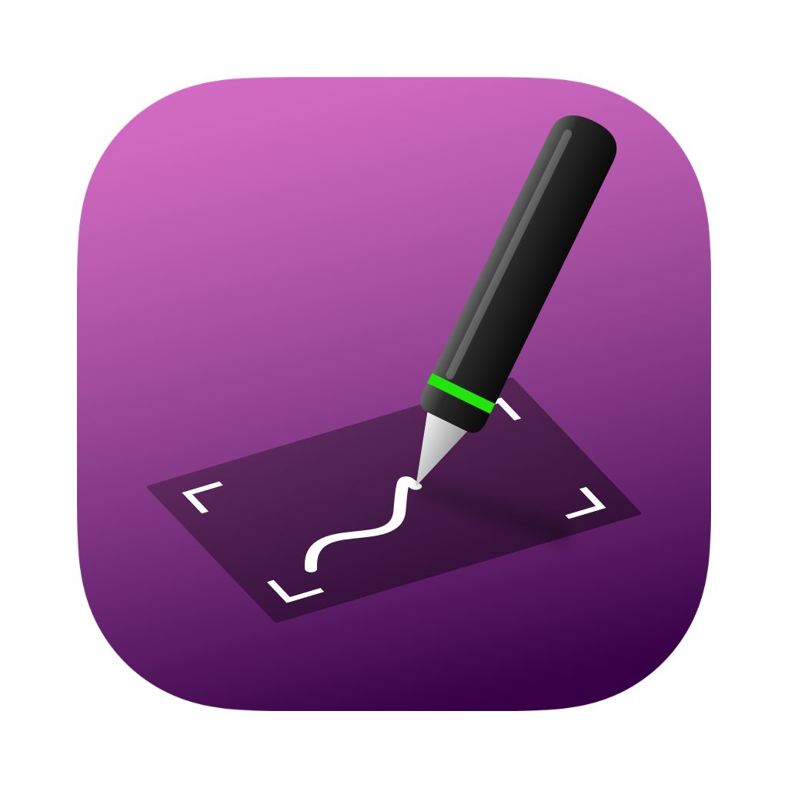

<p align="center"></p>

# Penlink

**A small user-space driver that brings the Wacom Intuos3 A5 Wide (PTZ-631W) back to life on current Macs.**

> ⚠️ **Alpha version (0.1.0-alpha).** Penlink works for daily use on the developer's machine, but it has only been tested on one Mac with one tablet. Expect rough edges.

Wacom no longer provides drivers for the Intuos3 series that run on current macOS versions, and the old drivers rely on a kernel extension that does not load on Apple Silicon. Penlink is a menu-bar app that talks to the tablet directly over USB (IOKit HID) and turns pen input into regular macOS pointer events with pressure and tilt. No kernel extension, no system extension, no admin rights required.

## Features

- **Pen** with 1024 pressure levels and tilt, passed on as tablet events (works in apps that read pressure, e.g. Photoshop, Affinity, Krita)
- **Eraser** is recognized as an eraser
- **Side buttons:** lower button = right-click, upper button = double-click
- **Monitor mapping:** map the tablet to a single monitor or to all monitors
- **Tablet area panel:** a picture of the tablet with a dashed frame you can move and resize to choose which part of the tablet maps to the screen; optional "keep monitor aspect ratio"; changes take effect when you click OK
- **Dead zone against jitter:** the pointer stays still while the pen rests (makes drag & drop and spring-loaded folders work), without reducing precision — as soon as the pen moves, the pointer jumps to the exact measured position
- **Menu-bar app** with no Dock icon; works while menus are open
- Universal app (Apple Silicon and Intel)

## Supported hardware and system

| | |
|---|---|
| Tablet | Wacom Intuos3 A5 Wide **PTZ-631W** (USB ID `056A:00B5`) — the only model Penlink recognizes |
| macOS | 13 Ventura or later (built for macOS 13+) |
| Mac | Apple Silicon and Intel |
| **Tested on** | macOS 26.7 (Tahoe), Mac Studio M1 Ultra, PTZ-631W |

Other macOS versions and Intel Macs should work but have not been tested yet. Reports are welcome.

## Limitations (alpha)

- **Only the PTZ-631W** is supported. Other Intuos3 models use the same data format and could be added, but they need their own size values and testing.
- **ExpressKeys and the touch strip** do nothing.
- **The Intuos3 mouse** (4D/lens cursor) is not supported, only pen and eraser.
- **No settings for** pressure curve, button assignment, tip threshold or per-app profiles. Side-button functions are fixed.
- **The user interface is in German.**
- **Not signed by Apple** (ad-hoc signature only). macOS shows a warning on first launch; see installation.
- **The original Wacom driver must not run at the same time**, because it holds the tablet exclusively.
- Replugging and waking from sleep have not been tested much. If the tablet stops responding, quit and restart Penlink.

## Installation

1. Download `Penlink.zip` from the [Releases](../../releases) page and unzip it.
2. Move **Penlink.app** into your **Applications** folder.
3. **First launch:** right-click Penlink → **Open** → **Open**. If macOS still refuses, go to *System Settings → Privacy & Security* and click **Open Anyway**.
4. **Grant two permissions** when macOS asks (or add Penlink manually under *System Settings → Privacy & Security*):
   - **Input Monitoring** — to read the tablet
   - **Accessibility** — to move the pointer and click
   
   Then quit Penlink (menu-bar icon → *Beenden*) and start it again.
5. **Turn off the old Wacom driver**, if installed. Either uninstall it with the *Wacom Tablet Utility*, or disable its background services in Terminal:
   ```bash
   launchctl bootout gui/$(id -u)/com.wacom.wacomtablet
   launchctl disable gui/$(id -u)/com.wacom.wacomtablet
   launchctl disable gui/$(id -u)/com.wacom.displayhelper
   ```
   (Undo with `launchctl enable …`.)
6. **Start automatically:** *System Settings → General → Login Items → Open at Login → +* and choose Penlink.

## Usage

Click the pen icon in the menu bar:

- **Tablet-Fläche zuordnen zu:** choose a monitor or *Alle Monitore* (all monitors)
- **Tablet-Fläche einstellen …** opens the area panel: drag the dashed frame or its corners, toggle *Seitenverhältnis des Monitors beibehalten* (keep aspect ratio), *Ganze Fläche* resets to the full tablet, **OK** applies
- The menu also shows whether the tablet is connected and whether a permission is missing.

## Building from source

Requirements: the Xcode Command Line Tools (`xcode-select --install`). Xcode itself is not needed.

```bash
./build.sh
```

This builds `Penlink.app` (arm64 + x86_64) and `Penlink.zip`. The app is signed ad-hoc with a requirement based on its bundle ID, so macOS keeps the granted permissions across rebuilds.

For troubleshooting, start Penlink with `--debug`; it then writes the raw tablet data to `~/Library/Logs/Penlink.log`:

```bash
open Penlink.app --args --debug
```

## How it works

Penlink opens the tablet via IOKit HID, switches it from its built-in mouse mode to Wacom mode (feature report 2), decodes the 10-byte pen reports and posts `CGEvent` mouse and tablet events. The report format was taken from the documentation in the Linux kernel driver (`drivers/hid/wacom_wac.c`); no code was copied from it. Everything is in a single file, [`main.swift`](main.swift).

## License

[MIT](LICENSE). Not affiliated with or endorsed by Wacom. "Wacom" and "Intuos" are trademarks of Wacom Co., Ltd.

---

## Kurz auf Deutsch

Penlink ist ein kleiner Treiber für das **Wacom Intuos3 A5 Wide (PTZ-631W)** auf aktuellen Macs, für das Wacom keine funktionierenden Treiber mehr anbietet. Er läuft als Menüleisten-App ohne Kernel-Erweiterung, unterstützt Druck, Neigung, Radierer und Seitenschalter und lässt die Tablet-Fläche einem oder allen Monitoren zuordnen. Es ist eine **Alpha-Version**, getestet nur unter macOS 26.7 auf einem Mac Studio M1 Ultra. ExpressKeys, Touch-Strip und die Intuos3-Maus funktionieren nicht. Installation: siehe oben (App in den Programme-Ordner, per Rechtsklick öffnen, *Eingabeüberwachung* und *Bedienungshilfen* erlauben, alten Wacom-Treiber abschalten).
